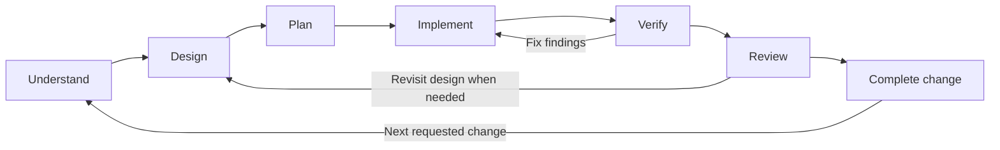

# Development workflow

This project uses a repeating development cycle: **Understand → Design → Plan → Implement → Verify → Review → Complete → the next requested change**. Each feature, bug fix, or refactor goes through the relevant stages. **Complete closes that bounded change; development continues with the next request.**

Within a cycle, findings can send work back to any affected stage: failed verification can return to implementation, and review can reopen requirements or design. Reuse the current specification, design, vocabulary, and roadmap across cycles, updating only what the change affects. Small changes need proportionate work rather than a fresh project-wide discovery exercise.

The diagram shows the usual cycle and example feedback paths. Any stage can revisit earlier decisions when evidence requires it. Completing a change does not itself authorise selecting and implementing more work.

## Understand

Use the shared [project-preferences guidance](project-preferences.md) across stages. New project records may include `docs/PREFERENCES.md` for overridable technology and supporting-skill choices. Understand reads relevant constraints, Design agrees choices and UI direction, and Plan/Implement follow that agreement. The [verification policy](verification-policy.md) connects user-visible outcomes to proportionate tests, architecture checks, rendered UI review and trustworthy evidence.

The [Understand skill](../understand/SKILL.md) is the available requirements-discovery skill. Its templates support the specification and optional domain vocabulary. Read and follow that skill; its instructions define the detailed interview and readiness checks.

Start with the user's idea or change request, applicable project instructions, and any existing records. For an existing system, inspect relevant code and tests. For a greenfield project, establish requirements through the conversation without assuming a product brief or solution that has not been supplied.

Produce:

- Requirements for a bounded scope, with concrete acceptance examples.
- Relevant constraints, exclusions, explicit assumptions, and unresolved questions.
- Shared vocabulary where it helps understanding.
- Accurate proposed-work status in the roadmap where useful.
- A handoff identifying readiness for Design or the decisions still preventing it.

Follow applicable project instructions for record locations; the bundle defaults are: the existing vocabulary file or new `docs/GLOSSARY.md`, `docs/ROADMAP.md`, and `docs/specs/`, using the skill's templates where needed. Ask focused questions, preserve earlier answers, and create only useful records. Questions that properly belong to Design can remain open and labelled as such.

Understand finishes after a recorded readiness review covers the material claims in the saved requirements, examples, constraints, glossary and rationale. Each claim needs applicable evidence or agreement and a concrete challenge with its result; a category-wide pass does not establish coverage. Unchecked or open claims keep **Clarification ongoing**. **Awaiting confirmation** applies only when the review is satisfied and the presented recap alone needs confirmation. **Ready for Design** requires supported claims, consistent records, and a recap confirmed or covered by applicable delegation. Confirmation alone cannot close a factual gap. After changes, reconcile all affected records and recheck the claims and their dependants. Keep specification, roadmap and handoff statuses consistent. The detailed review and questioning loop live in the skill.

When the request is limited to Understand, stop at its handoff. Continue into Design when requested. Requirements readiness does not imply that code exists or checks have passed.

## Design

The [Design skill](../design/SKILL.md) and its [design template](../design/assets/design.md) are installed. Use the current specification, domain context, relevant code and project standards as inputs. If no specification is present, obtain it from the human before inventing product requirements. An upstream readiness label does not establish every premise; clarify material uncertainties while continuing independent design work.

Design for clarity, testability and human verification. Select a proportionate architecture and explain how its responsibilities, interfaces and dependency boundaries serve those outcomes. Keep diagrams and evidence navigable by a human even when approval is delegated. SOLID and architectural patterns guide those choices; configured tool scores provide evidence about specific properties and do not establish overall design quality or replace human judgment.

Produce the authoritative living Markdown design, including:

- Technology choices, responsibilities, boundaries and significant rationale.
- Mermaid C4 context, container and component views with stable identifiers.
- Required drill-down into each affected component's proposed code structure: modules, important types/interfaces/functions and relationships, proportionate to the component.
- Existing or proposed source mappings, including TypeScript paths/packages or Rust crates/modules as applicable; explicit allowed, required and forbidden dependencies.
- Important flows, intended behaviour tests, and an approach to comparing actual code with the design.

Small systems use `docs/design.md`. Larger designs may split into linked system, container and component records under `docs/design/`, with parent/child navigation and one authoritative home for shared decisions. Diagrams, mappings and rules must describe the same agreement.

During Verify and Review, derive observed code-level views from actual source and compare them with the intended structure. Identify the source snapshot, extraction tool or agent-inspection method, source links and coverage limitations. Keep intended and observed views distinct. Report automatically checked, AI-assessed, human-reviewed and unresolved claims separately; diagrams do not establish behaviour, and AI judgment cannot override a configured check failure.

Before implementation exists, observed views remain pending. Design defines that later comparison work and does not create application code to fill the gap. Obtain design agreement unless the human has delegated that authority. Keep one status: **Design in progress**, **Awaiting agreement** or **Ready for Plan**. When the request is limited to Design, stop at its handoff to Plan. Continue into Plan when requested.

## Plan

Use the [Plan skill](../plan-delivery/SKILL.md) to turn the current requirements and agreed design into one roadmap, with linked phase plans where useful. Preserve existing agreement and inspect the affected code and tests when planning changes to an existing system. Plan every phase of the requested feature or change with tasks, dependencies and completion evidence. The next phase may have finer detail. Leave later work as an outline only when the user requests that depth or a specific unresolved decision prevents useful detail; record the reason, affected scope and what will resolve it. An unfinished predecessor blocks execution, not planning its dependants.

Tasks connect to requirements, design elements and intended evidence. State real prerequisites, observable acceptance conditions and relevant verification. Include integration, documentation updates, and work to derive observed code views and compare them with the agreed design. For refactoring, describe coexistence, migration and removal of temporary exceptions. Missing required checks need explicit setup work or remain a verification gap.

After drafting, perform a distinct review starting from the original requirements, design, project instructions and workflow. Derive the obligations before checking the plan's coverage claims, so omitted work remains visible. Prefer a fresh reviewer when available and permitted; otherwise use a separate self-review pass and record that limit. Check every phase for missing work, credible evidence and actual dependencies, then apply findings and recheck the affected records. The Plan skill defines this review; it is not a new lifecycle stage or approval checkpoint.

State whole-request planning coverage separately from readiness of the next execution scope. Use **Planning in progress**, **Awaiting agreement** or **Ready for implementation** for each named scope, applying existing project authority without adding a mandatory approval step. Missing required work or planned evidence prevents a full-coverage claim. Track delivery separately: writing or agreeing a plan does not complete implementation. A ready first phase does not complete missing planning for later phases; later execution dependencies do not prevent independent ready work.

A request to plan ends with the records, next task, expected evidence and remaining dependencies. Continue only within the user's authorised scope. Each phase proceeds through the relevant implementation, verification, review and completion responsibilities; new information can reopen earlier stages.

## Delivery: Implement, Verify, Review and Complete

Three skills carry the agreed plan through delivery. Read the [delivery contract](delivery-contract.md) for shared assignments, evidence, role authority and completion conditions. A local application-delivery trial has exercised this path; live-service acceptance, enforced permissions and release automation remain separate validation work. New instruction revisions still need practical evaluation.

| Skill | Responsibility and handoff |
|---|---|
| [Implement](../implement/SKILL.md) | Build the assigned scope, test and fix, compare affected code with the design and return evidence plus a local diff or authorised PR. Address review findings within the assignment. |
| [Review Change](../review-change/SKILL.md) | Assess the actual patch against requirements, design and standards. Return snapshot-specific findings and evidence limits. Review does not itself merge or publish comments. |
| [Orchestrate Delivery](../orchestrate-delivery/SKILL.md) | Dispatch ready work, coordinate ownership, collect reports and reviews, resolve findings, integrate when authorised, verify the combined result and reconcile current records. |

Verify is shared work inside implementation and review; Complete is coordinated by the orchestrator. No additional mandatory skill per stage is needed. Required checks remain blocking if unavailable or failing. Discover the project’s actual analysis tools and configuration; disclose unsupported architecture analysis and use labelled source inspection where the agreement permits it.

An authorised request to execute an agreed plan carries through its phases; each next task is an assignment within that delivery scope. For an unqualified Orchestrate Delivery invocation, use the current agreed plan when unambiguous, subject to existing user limits. Announce the scope and continue through ready work without a new request at every phase boundary. An explicit phase-only request stays limited. Keep local implementation authority separate from commit, publication, integration and release authority: a pending merge does not itself prevent safe, authorised local work. Record actual dependency blockers and unfinished product behaviour rather than treating foundation tooling as an application delivery.

Workers submit changes and evidence. Only the orchestrator among AI roles may merge into shared integration/default branches or release, within granted authority; authorised humans retain both abilities. Plan readiness does not grant execution permission, and permission to implement does not automatically grant publication, merge or release. Use existing delegation without repeated confirmation for actions it already covers.

The orchestrator can review directly or use a fresh reviewer when permitted, retaining responsibility for the integration decision. After fixes or relevant changes to the patch/base/target, reassess affected evidence. After merge, confirm the target state and applicable combined checks before marking the scoped delivery complete. Record blocked work and continue independent authorised tasks; never count a missing worker report as success.

Release remains a later extension, separate from completed integration. These skills stop at the integration handoff unless a project-specific release procedure and explicit authority are available; they do not invent publishing commands or deployment targets.

Delivery handoffs begin with a concise human-readable outcome, verification limits, remaining work and next action, following Orchestrate Delivery's human-facing handoff guidance. Keep the current summary at the top of the roadmap and coordinator checkpoint; link detailed evidence and recovery records rather than reproducing them in the conversation.

## Interruptions and resumption

Delivery records must survive a new agent session. The [delivery contract](delivery-contract.md#checkpoint-and-resume) defines checkpoint ownership, storage, update points and reconciliation. The orchestrator links one current checkpoint from the roadmap; workers and reviewers save partial progress in their own assigned reports. Record pending consequential operations before attempting them and confirm results afterward, so a cutoff does not turn an uncertain operation into a duplicate action.

On resume, compare saved records with actual Git, PR/check and worker state. Confirm ownership before replacing a writer, invalidate affected stale evidence and resume at the next safe action. A merged PR with missing completion records resumes at integration verification and reconciliation. Preserve existing pauses and authority limits. File-based checkpoints support recovery by a new session; automated restarts, usage replenishment and storage/permission enforcement are not implemented.

## Feature navigation and build coordination

Before changing requirements, locate affected capabilities and their authoritative specifications. Keep a lightweight feature map in `docs/specs/README.md` when multiple records need navigation, linking substantial capability specs and their design. A small system can keep one spec; group folders only as useful. Preserve stable references and update links when splitting records. Shared vocabulary and rules stay authoritative in one place. Proposed changes remain distinct from delivered behaviour until implementation and evidence justify updating that status.

The feature map explains what belongs where; the single roadmap shows build progress across feature cycles. Use ⬜ Planned, 🟡 In progress, 🚧 Blocked, 🔎 Verifying/reviewing and ✅ Complete with text labels, plus separate Deferred/Cancelled states. Keep lifecycle readiness separate. Each active row links its specification/design, owner or unassigned status, dependencies/blocker, task detail and evidence.

Plan records bounded assignments and safe parallel opportunities. During authorised parallel execution, a coordinating agent maintains the roadmap, reconciles worker reports and owns or assigns integration and combined verification. Workers have explicit edit scope and shared-interface agreements; shared records need one writer or a coordinated edit sequence. Workers return evidence and blockers; absent reports are gaps. Mark scoped work complete only after applicable acceptance, checks, review and integration are evidenced. Reopen affected status when later changes invalidate that evidence. A single agent can fulfil these responsibilities without additional machinery.

## Records and rules

Current requirements and design live with the code. Keep planned scope distinguishable from delivered behaviour. Use one roadmap and additional phase documents under `docs/phases/` only where useful. Git preserves earlier versions; tracker issues and permanent change archives are unnecessary for this workflow.

As engineering standards and checks are selected, record them in a separate conventions and rules document and link it from the project instructions. It should explain which rules are enforced, their actual settings, exceptions, and which guidance still requires judgment. Keep executable settings aligned with their documentation.

This bundle does not install an analysis executable or configure project checks. Discover existing commands and engineering rules in the target repository. Missing future tooling does not block Understand, Design or Plan. Before implementation is reported as verified, the agreed checks and evidence must be available and pass. During later work, run applicable configured checks before commits; an unavailable required check remains incomplete.

Resolve disagreement between code and intent through a fix or an authorised change to the specification or design. Do not silently rewrite the agreement or relax checks to excuse a defect. Final human acceptance remains a project choice, independent of required technical checks.
