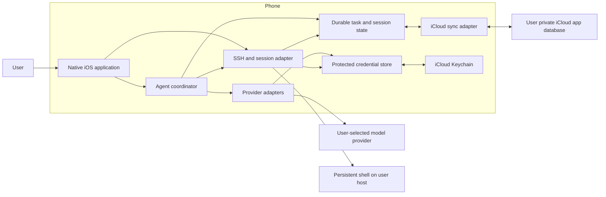
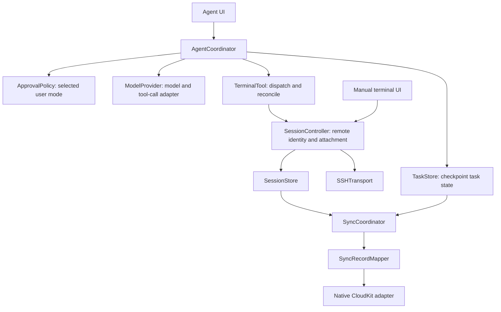

# Warp iOS runtime architecture proposal

**Design status:** Design in progress.
**Agreement:** The user accepted the MVP runtime division: phone-owned agent coordination and provider credentials, with persistent remote shell command execution. Multiple named sessions across saved hosts are also confirmed. Detailed background-setting semantics and recovery presentation remain to be defined.
**Scope:** MVP runtime, native-stack direction, synchronization and release boundaries, and representative command/recovery journeys. This is not the full application design, a Ready for Plan handoff, or implemented code.
**Requirements:** [Product foundation](specs/product-foundation.md), especially AGENT-03, AI-01, SESSION-01, SETUP-01, and SSH-01.
**Evidence:** [Execution research](research/ios-execution.md), [native/Expo/sync research](research/native-stack-and-sync.md), and [project preferences](PREFERENCES.md).

## Proposed responsibility boundary

| Element | Owner and responsibility | Proposed source area; not existing code |
|---|---|---|
| APP — iOS application | User interaction, terminal display, agent conversation, selected provider/approval preferences | `WarpIOS/App`, `Features/Terminal`, `Features/Agent` |
| AGENT — phone coordinator | Task state, model calls, interpretation of tool requests, approval policy, execution dispatch and recovery | `WarpIOS/Agent/AgentCoordinator`, `AgentTaskStore` |
| MODELS — provider adapters | OpenAI, Anthropic, DeepSeek and Qwen request/response and tool-call translation; actual model compatibility must be tested | `WarpIOS/Providers/ModelProvider`, individual adapters |
| SECRETS — phone credential store | Protected SSH/provider credentials, including user-approved iCloud Keychain synchronization; stable identifier lookup and separate credential-sync availability | `WarpIOS/Credentials/CredentialStore` |
| EXEC — phone SSH/session adapter | Connect, verify host capability, attach persistent remote session, send commands, receive output and reconcile in-flight work | `WarpIOS/Execution/SSHTransport`, `SessionController` |
| STATE — durable phone state | Conversation/task checkpoints and host/session identity, separating submitted commands from known results | `WarpIOS/Persistence/TaskStore`, `SessionStore` |
| SYNC — iCloud adapter | Account-scoped synchronization of the agreed app records, conflict/deletion handling and visible sync status; never dispatches commands | `WarpIOS/Sync/SyncCoordinator`, `SyncRecordMapper` |
| RELEASE — build/distribution tooling | Signed native build and TestFlight/App Store Connect handoff, evaluating EAS services against the actual project | `ci/`, release configuration; not an app runtime module |
| HOST — user-supplied remote host | Persistent shell/session and command execution, independent of the phone process; no model-provider credentials or remote agent coordinator required by this proposal | Repository bootstrap/cloud-init plus a host session mechanism; exact implementation pending |

The selected engineering direction is Swift/SwiftUI with a UIKit terminal adapter for iPhone and iPad. SwiftTerm and Citadel/NIOSSH are documented native candidates; release pins and live validation remain pending. Native CloudKit app-data synchronization is an MVP boundary; choose one app-data synchronization owner against the agreed scope. Credential synchronization uses native iCloud Keychain as a separate system mechanism. Assess EAS Build/Submit independently from the app runtime. The exact persistence implementation, minimum OS version and remote session mechanism are not finalized yet. A phone-owned coordinator does not imply local model inference: BYOK model requests go to the configured provider. If the user means on-device inference instead, reopen that product interpretation rather than claiming BYOK establishes it.

## Context and runtime view

Edges describe intended calls/runtime communication, not a verified import graph. Provider credentials remain on the phone in this proposal; the host receives terminal operations rather than a model-provider key. Model requests may contain relevant task/terminal context; exact disclosure controls and redaction belong in the agreed data contract. Diagram rendering has not been visually validated.

## Proposed component drill-down

These names identify proposed responsibilities, not final types or implementations. Both direct terminal and agent operations share session/execution boundaries. A session is bound to a saved host and persistent remote identity; switching the visible session does not terminate other remote work. Multi-device state synchronization and agent concurrency remain distinct from multiple saved sessions. Concurrency/input ownership must be specified so manual input and an agent do not corrupt each other's terminal state. Host output is untrusted data; it cannot grant execution authority or override the selected approval policy.

Proposed dependency rules: UI invokes coordinator/session interfaces; coordinator invokes provider, approval, state and execution interfaces; provider adapters do not independently execute tools; SSH adapters do not make model decisions. Credential access belongs behind the credential boundary. The sync adapter cannot invoke execution/provider tools or promote replicated history into runnable work. Runtime credentials are excluded from ordinary CloudKit data. Password/key direct SSH is MVP scope; bastions, MFA and port forwarding are excluded. Default-for-unlisted dependencies and automated architecture tooling are not configured; source conformance remains pending. Swift import/source inspection and any applicable analyser support must be defined in the later full design/check contract.

## Representative task flow

1. The user gives a typed task and selects task-level or per-command approval.
2. The phone coordinator checkpoints task intent and obtains a model response through the configured provider adapter.
3. A proposed terminal action is evaluated against the selected approval mode and task scope.
4. The phone dispatches the action over SSH into the attached persistent remote session and records submission separately from completion.
5. Remote output returns to the terminal and agent context; the phone decides whether another model/action step is needed.

Tool-call schemas, command completion markers, execution/output boundaries, cancellation, and interactive-program support remain to be designed and tested. A raw PTY stream alone does not prove the agent can correctly classify command completion or structured results.

## Interruption and recovery proposal

- **Foreground / permitted background execution:** the phone can coordinate agent steps while iOS grants runtime and required connectivity remains available. A configurable continuation preference governs attempts to keep working; it does not override the OS.
- **Loss of host connectivity:** already-running server commands remain in the persistent session, subject to host health. New remote dispatch is unavailable. Do not automatically replay commands whose outcome is unknown.
- **Phone suspension:** the agent cannot make new decisions while its process is suspended. Remote work already started can continue.
- **Phone termination:** durable phone state enables restoring the task and remote session identity on relaunch. Reconcile the remote task before sending another command; never interpret absence of an acknowledgement as proof the command did not run.
- **Host process loss/reboot:** shell persistence is not automatically host-reboot recovery. The UI must reflect observed state; the desired recovery scope remains unresolved.

Apple offers user-initiated continued-processing background APIs; investigate their applicability and test real-device behaviour before selecting a minimum OS or promising long-running background agents. There is no guaranteed always-on phone coordinator in this proposal.

## Synchronization and device ownership

**Accepted requirement:** iCloud app-data and credential synchronization both belong in MVP. Saved host profiles, preferences, persistent remote session identities and agent conversations use CloudKit; SSH credentials and model-provider keys use iCloud Keychain. The user explicitly confirmed both mechanisms. Raw terminal scrollback retention/sync is not equivalent to preserving a remote session and remains to be scoped.

State has three distinct lifetimes: the device's local replica, the user's iCloud records, and the remote host's live terminal sessions. Sync preserves records; reconnect attaches a transport; neither action alone launches an agent or runs a command. One synchronization adapter owns schema/version/conflict policy rather than independently editing both a Core Data mirror and CKSyncEngine store.

A second device may discover a saved session through CloudKit and resolve its credentials through iCloud Keychain. These mechanisms may converge at different times, so session attachment requires usable credentials and current host capability rather than metadata alone. Converging records must not automatically take over an active agent. Before dispatch, verify execution ownership at the host boundary using a session/task identity and a fencing/ownership mechanism defined by the helper. A stale cloud record is not sufficient evidence that the prior coordinator stopped. If ownership cannot be established, display the state and avoid duplicate dispatch. The exact multi-device takeover UX and helper mechanism require definition/validation.

Synchronizable Keychain records use stable app credential identifiers, not cross-device persistent Keychain references. Separate app-data synchronization from credential availability; test metadata-first arrival, credential update/removal and disabled/unavailable iCloud Keychain. The model/SSH adapter receives a usable local Keychain item through the credential store. Receiving a credential or history update alone does not start a task.

Edits and deletion tombstones preserve stable record identities. Account change/sign-out must separate replicas and prevent another account's history from appearing or affecting execution. Unavailable/delayed iCloud sync has a visible state; local app persistence supports the ongoing terminal without promising cloud convergence by a fixed deadline. The no-iCloud onboarding behaviour remains to be finalized.

## Device and release experience

Use native form-factor layouts: a compact session/agent switch on iPhone and a larger navigable session area on iPad. Both must support touch text selection, paste, control-key input and hardware keyboards in the terminal; verify fullscreen interactive programs and resize events rather than merely rendering a prompt. These are proposed acceptance details derived from desktop-like interaction, not claims of implemented layouts.

The release pipeline produces an Xcode-signed IPA and validates it through TestFlight before an authorized App Store submission. Evaluate EAS Build/Submit against that native project; do not add a React Native runtime solely because the user likes Expo distribution services. Expo with native modules remains a credible alternative and is not ruled out by the native-component preference. Document actual build/signing/service versions and account/entitlement dependencies when exercised.

## Alternatives and tradeoffs

**Phone-owned coordinator — recommended MVP:** matches the user's expectation, keeps model credentials on the phone, and leaves the remote host focused on persistent terminal execution. New reasoning/dispatch pauses when the phone cannot execute.

**Host-owned coordinator — not selected:** could keep planning and issuing commands while the phone is terminated, but changes the product/runtime expectation and requires an independent model-access/credential contract on the host.

**Optional explicit handoff — later research requested by the user:** a separate executor could take ownership of a task when requested. This needs durable authority/state transfer and duplicate-execution prevention, not merely a background setting. It is not implied by existing-host setup or selected as MVP scope.

## Required evidence and handoff gap

The [numbered MVP gap draft](specs/mvp-gap-proposals.md) now proposes retention, recovery, agent-control and cross-device/account outcomes for product confirmation. These are requirements proposals, not selected implementations. Existing architecture directions remain provisional where they depend on those decisions; confirmation must be reconciled here and in the phase plan before a handoff.

Before full design readiness: define raw terminal retention and recovery/takeover UX, define the phone-agent continuation setting, host/task boundaries and provider contracts, and complete the native/SSH/persistence feasibility assessment. The draft [MVP phase plan](phases/mvp.md) records validation and closing work; it does not claim those checks ran. Later verification must exercise direct and agent-driven terminal operations, both approval modes, lost acknowledgements, app suspension and actual termination/relaunch, and host-capability failures. Compare observed source responsibilities against the intended views, including code links and coverage limits.

No app, live model task, SSH session, background task, or architecture conformance check has been implemented or executed. This document resolves neither full requirements readiness nor full planning coverage.
